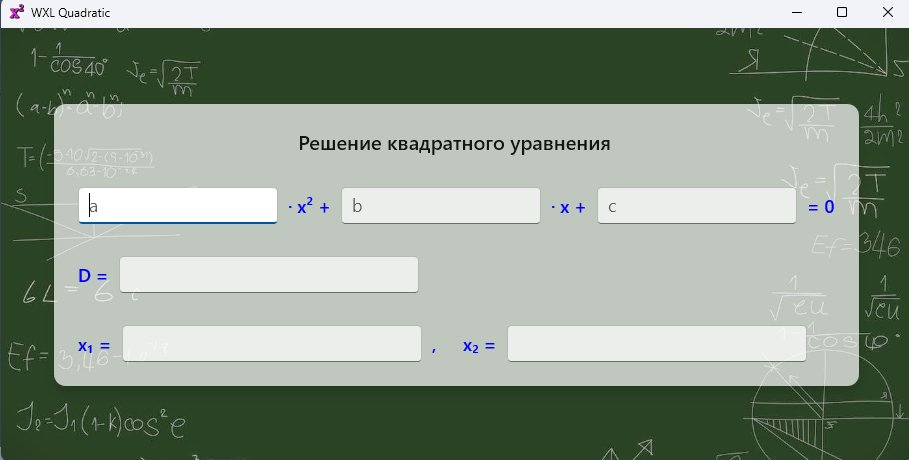

# Quadratic: квадратное уравнение на `observable`

## Назначение примера

Шаблон для небольших расчётных утилит: несколько полей ввода, несколько
полей вывода и модель, которая пересчитывает одно из другого.

## Обзор реализации

Три коэффициента на входе, дискриминант и два корня на выходе. Всё
приложение — один файл `main.cpp` размером около двухсот строк, а интерфейс
описан одним выражением.

Обработчиков событий ввода нет: правка любого коэффициента сама доходит до
модели, модель пересчитывает корни, и результат сам попадает на экран.

Что показано: реактивная модель на `observable`, односторонние привязки
`BindInput{}` и `BindOutput{}` вместо обработчиков, `NumberBox` для ввода
чисел, вложенные пресеты, подписи полей ввода через плейсхолдеры, фоновое
изображение на сцене `CompositionWindow`, матовое стекло под карточкой
(`GlassEffect` размывает сцену окна, чтобы текст читался поверх картинки) и
вычисление корней без потери точности.

```
cmake --build --preset x64-debug --target sample.quadratic
```

## Модель считает, интерфейс показывает

Класс `Equation` — это поля с оповещением об изменении и цепочка пересчёта
между ними:

```cpp
answer.follow(a, b, c, solve)       // три числа → ответ
      .on_change(...);              // ответ → три текста
```

`follow()` вычисляет значение сразу при создании и затем при каждом
изменении любого из источников; `on_change` раскладывает ответ по трём
полям, которые показывает интерфейс. Интерфейс об этой цепочке не знает: он
видит только поля. Коэффициенты объявлены как `observable<double>`, и число
в них записывает привязка к `NumberBox` при каждом нажатии клавиши. Пустое
поле у `NumberBox` — это NaN, и такой коэффициент модель считает не
введённым.

## Модель живёт до конца работы

Привязка хранит адрес поля модели и не владеет им, поэтому модель обязана
пережить все свои привязки. Окно держит себя само до `WM_NCDESTROY`, а жизнь
модели продлевает обработчик `Teardown`: функция `wxl_launched()` создаёт
модель через `std::shared_ptr` и захватывает его в обработчик, который wxl
вызывает при завершении программы.

## Привязка вместо обработчиков

`intermediateValue = BindInput{eq.a}` у поля ввода, `text = BindOutput{eq.D}`
у поля вывода — и больше ничего. Направление названо в самой привязке:
коэффициент идёт из `NumberBox` в модель и только туда, модель поле ввода
никогда не переписывает; ответ идёт из модели в `TextBox` и только туда, а
поля ответов объявлены `isReadOnly` и только показывают. Двусторонняя
привязка `Bind{}` здесь не нужна ни одному полю.

У `NumberBox` два значения. `value` — подтверждённое: контрол записывает его
по Enter, по уходу фокуса или по кнопке-спиннеру, а до того не меняет.
`intermediateValue` — число в том виде, в каком оно набрано прямо сейчас,
обновляемое при каждом нажатии клавиши: wxl разбирает текст поля тем же
форматтером, которым `NumberBox` впоследствии подтвердит его сам, поэтому
модель видит то, чем `value` вот-вот станет. Текст, который числом ещё не
стал («−», «1e»), даёт NaN, и ответ на это время — прочерки, как при пустом
поле.

Ни один элемент управления не хранится в переменной: всё, ради чего его
пришлось бы держать, записано декларативно, включая установку фокуса в
первое поле через `onLoaded`.

## Плейсхолдеры вместо подписей

Поля ввода подписаны изнутри: `placeholderText = u"a"`. Строка полей
читается как формула `a · x² + b · x + c = 0`, и отдельных подписей рядом с
полями не требуется. Общий вид задают пресеты `common`, `txt`, `input` и
`output`; пресеты вкладываются друг в друга, что позволяет использовать
определения повторно.

## Фон — на сцене окна, а не в дереве XAML

```cpp
background = BackgroundImage {u"Assets/GlassBackdrop.png", BackgroundFill::UniformToFill}
```

Изображение размещается визуальным объектом на сцене `CompositionWindow`,
под прозрачным островом XAML. Элемента `Image` в дереве нет: изображение не
участвует в раскладке острова и меняет размер синхронно в обработчике
`WM_SIZE`, поэтому держится за рамку окна без отставания при изменении
размера.

Само окно создано со стилем `WS_EX_NOREDIRECTIONBITMAP`: поверхности
перенаправления у него нет, и при быстрой растяжке за угол в просвете не
белеет ни пикселя. Декодирует и хранит изображение кэш текстур Win2D,
которым окно управляет само.

## Корни без потери точности

Школьная формула `(−b ± √D) / 2a` верна на бумаге, но теряет точность в
`double`. Когда `b² ≫ 4ac`, значение `√D` почти равно `|b|`, и у меньшего по
модулю корня в числителе вычитаются два почти равных числа — значащие цифры
пропадают:

| `a = 1, b = 1e8, c = 1` | меньший корень  |
| ----------------------- | --------------- |
| школьная формула        | −7.4505806e−09  |
| этот пример             | −1e−08          |
| точное значение         | −1.00000000e−08 |

Пример вычисляет `q = −(b + sign(b)·√D) / 2`: слагаемые одного знака,
вычитания нет. Корни берутся как `q/a` и `c/q`, второй — по теореме Виета
(`x₁·x₂ = c/a`). Вырожденные случаи обрабатываются явно: `a = 0` —
линейное уравнение, `b = c = 0` — ℝ, `b = 0` при `c ≠ 0` — ∅, `D < 0` — пара
комплексно-сопряжённых корней. Корни хранятся как `std::complex<double>` и
печатаются тем же вызовом `format(u"{:.9g}", root)`, что и дискриминант:
девять значащих цифр у каждой части, например `(-1+2i)`; вещественный корень
выглядит как `(1.64575131+0i)`.

Ввод разбирает сам `NumberBox` по правилам текущей локали; вывод — девять
значащих цифр.

## Снимок экрана


